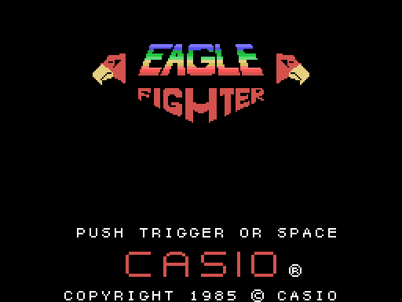
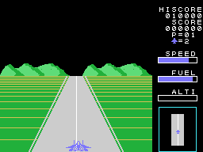
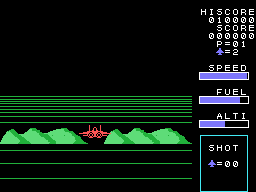
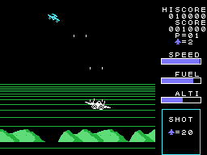
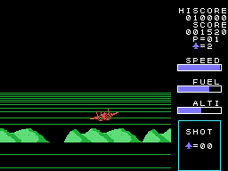
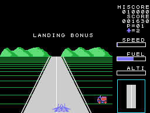
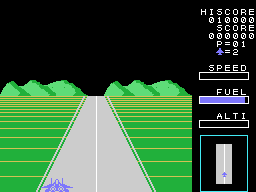
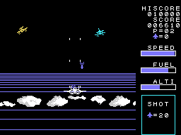

# The game

*Eagle Fighter* is a jet-fighter game seen from behind: the plane takes off from a runway drawn in perspective,
shoots down the waves of enemy planes, comes back and lands. The fuel runs down all the time, and what is left on
landing is paid in points. There are sixteen stages, in [The stages](THE-STAGES.html).

Every GIF on this site is the ROM **running in openMSX** (a Japanese MSX1 with C-BIOS, at 60 frames per second):
on every frame the VRAM, the RAM and the VDP registers are logged, and `tools/vdp.py` paints them. The game ones
are a simple pilot written for it (`tools/guiones/partida.tcl`): it accelerates down the middle of the runway,
takes off, fires, comes down and lands.

## The title and the demo

The title draws the logo with its two eagles, PUSH TRIGGER OR SPACE, CASIO and the copyright (`titulo`, 0x80B0);
every 8 frames a jet comes in from the right (`titulo_avion`, 0x9A2A). With no button for a few seconds, the
**demo** starts on stage 9 with DEMO PLAY: the game moves the stick itself, accelerates, takes off and crashes
(`interrupcion_demo`, 0x99AE).

## The controls

| | joystick | keyboard |
|---|---|---|
| speed on the runway, height in the air, left and right | joystick 1 | the cursor keys |
| take off and fire | the button | the space bar |

The game reads both sticks and **adds them up** (`palanca_lee`, 0x998E). In the air the controls are those of a
plane: **up dives, down climbs**.

## The runway and the take-off

On the runway, up accelerates one step every 8 frames up to 0x60, down brakes two, and with the stick released
the speed drops slowly (`velocidad`, 0x85AB); the bar is SPEED. Left and right move the plane; near the edges it
bumps, and off the runway it **crashes** (`pista_lado`, 0x861F). From a speed of 0x10 on, **gusts** of wind push
it sideways at random (`viento`, 0x88CF).

To take off: down and the button (`despega_empieza`, 0x869B). Too slow, the plane hops and comes back down; at 0x5A
or more it keeps climbing, the runway falls behind and TAKE OFF:BONUS 1000PTS. blinks: **1,000 points**
(`despegue`, 0x835D). If it takes off away from the centre line, it crashes when it comes back down.

## In the air

Up to **four shots** at a time, which go up four dots per frame (`tiros`, 0x8934). The enemy planes come in waves;
the SHOT box on the radar counts down the ones left to shoot (20 on the first stage). An enemy, or one of its shots,
touching the plane makes it crash. Each enemy is worth its points, 20 to 90 ([The stages](THE-STAGES.html)).

## The fuel

The tank starts full (0xC0) and loses one unit every 32 frames; the bar is FUEL, and below 16 an alarm sounds
(`barras`, 0x8CB5). **With no fuel the plane can only go down** (`vuelo_cuadro`, 0x8752), and with no fuel on the
runway before taking off, it crashes.

From stage 3 on, the code has an in-flight refuelling: after the big enemy, a tanker drawn with tiles comes down
from the top of the screen, four warnings, and with the plane underneath and the stick down the tank fills up
(`cisterna`, 0x8B08). **No recording reached it**: it is described from the code.

## The landing

With the count at 0, LANDING: the runway comes back on the radar (`aterrizaje`, 0x8A89). Low enough, the runway
comes towards the plane over the ground; touching the ground **before** it arrives is a crash (`altura_barra`,
0x8D1A). The plane has to touch down in the middle of the runway and brake until it stops; then LANDING BONUS:
**10 points for every unit of fuel left**, while a vehicle drives up to the plane (`aterriza`, 0x9694). Then the
next stage.

## The lives

The game starts with **two spare lives**, shown next to the little plane; one more every **20,000** points, up to
9 (`puntos_suma_cien`, 0x97A8). A crash blinks the plane for 160 frames with its tune and starts the stage again
(`nave_cae`, 0x95E6); with no lives left, GAME OVER (`game_over`, 0x967A).

