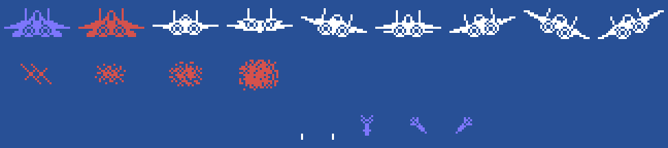
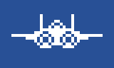
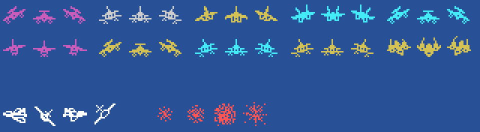

# The sprites

Everything on this page is **put together from the ROM tables** with `tools/hojas.py`: the drawings are the 0x800
bytes at 0xB800 that `sprites_dibujos` (0x987A) puts as they are at 0x3800, and every figure is built with the
drawings, colours and places the code gives it. None of these images is a screenshot.

**Checked against openMSX** on the three recordings of this site:

- the sprite drawing table (VRAM 0x3800-0x3FFF) is **identical** to the game's on 17,190 frames (3 more catch the
  copy halfway);
- the plane's two sprites (0xE100) match on 12,642 frames, and crashed on 2,678; on 8 one half has already changed
  and the other not yet; **5 unexplained**;
- the enemies in the air (the sprite 0xE128 + 8 × their number, their data 0xE360 + 32 × it) have the drawing and
  the colour of their type on **8,018 frames, 0 different**, and are blowing up on 791 more;
- the enemies' shots (sprites 4-9) on 2,370 frames, and blowing up on 151; **0 different**.

## The plane

Two sprites: the drawing and the drawing + 4, 16 dots to the left (`fase_empieza`, 0x822B). On the runway 0x00, in
light blue and dark red, which change every 2 frames (`vuelo_pista`, 0x8589); in the air, by the controller
(`vuelo_palanca`, 0x8774): still 0x08, up 0x18 (it dives), right 0x20, down 0x10 (it climbs), left 0x30, and 0x28
or 0x38 on the diagonals, in white and dark red every 2 frames (`avion_color`, 0x88B4). Crashed (`nave_cae`, 0x95E6), both
sprites take the same drawing, 0xE8, 0xEC, 0xF0 and 0xF4 every 4 frames, one 6 dots to the left and the other 5 to
the right. Below, its shot (0xF8, white, `tiros` 0x8934) and the enemies' shots (0xAC straight, 0xA4 and 0xA8
diagonal, light blue, `enemigo_dispara` 0x7073):

In the air with the controller in its eight directions, blinking, and crashed, at the game's pace:

## The enemies

One sprite each, with the drawing and the colour of its type (`tipo_1` ... `tipo_12`): 0x8C in magenta, cyan or
dark yellow, 0x68 in grey, cyan or dark yellow, 0x74 in dark yellow, 0x80 in cyan, 0x5C in magenta and 0x50 in dark
yellow; each one head-on and with its drawing - 4 or + 4 when it goes to one side or the other (`paso`, 0x7B79).
Below, the big one (0x94, 0x98, 0x9C and 0xA0 in white, by the steps of 0x796C) and the explosion (0xEC, 0xF0 and
0xF4, or 0xFC from type 6, in red, `explosion1` 0x727D; on the left half of the screen the first step does not
change the drawing, only the colour):

Shot down: three drawings of 4 frames each, at the game's pace:

