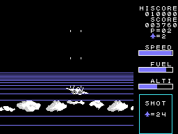

# The stages

Sixteen stages, P=01 to P=16 on the status line (0xE00A, from 0 to 15); after the sixteenth, the first one again
(`aterriza`, 0x972E). Each stage takes its data from tables of sixteen entries, one per stage.

| stage | enemies to shoot (0x7020) | after the refuelling (0x7030) | waves |
|---:|---:|---:|---|
| 1 | 20 | 20 | 0x7CDF |
| 2 | 24 | 20 | 0x7CF4 (also the demo's) |
| 3 | 28 | 30 | 0x7D0C |
| 4 | 30 | 35 | 0x7D27 |
| 5 | 34 | 40 | 0x7D42 |
| 6 | 38 | 40 | 0x7D42 |
| 7 | 40 | 40 | 0x7D42 |
| 8 | 44 | 50 | 0x7D42 |
| 9 | 40 | 50 | 0x7D42 |
| 10 | 50 | 50 | 0x7D42 |
| 11 | 60 | 60 | 0x7D42 |
| 12 | 70 | 60 | 0x7D42 |
| 13 | 80 | 70 | 0x7D42 |
| 14 | 80 | 70 | 0x7D42 |
| 15 | 99 | 99 | 0x7D42 |
| 16 | 99 | 99 | 0x7D42 |

The counts are BCD, as the SHOT box shows them. The colour of the ground changes with the stage (0x8548 on the
runway, 0x8558 in the air) and so does the landscape on the horizon (0x8F94, 0x8FB4): stage 2, in the recording, is
blue sea with clouds.

## The waves

A wave is a list of entries of three bytes: the enemy type, the wait between one and the next and how many; 0xFF
with an address goes back to it, and all five lists go back to their start (`oleada`, 0x7363). Up to six enemies
and six enemy shots are on screen at once (`enemigos_todos`, 0x7C5A); on stage 1, only three enemies.

## The enemy types

Twelve types put a new enemy at the top of the screen, at a distance from the plane and on the side opposite to
the half it is in (`tipo_1`-`tipo_12`, the table at 0x742F):

| type | movement | drawing | colour | points |
|---:|---:|---|---:|---:|
| 1 | 1 | 0x8C | 13 | 30 |
| 2 | 2 | 0x68 | 14 | 30 |
| 3 | 3 | 0x74 | 10 | 40 |
| 4 | 4 | 0x80 | 7 | 50 |
| 5 | 5, the big one | 0x98 | 15 | 90 |
| 6 | 3 | 0x74 | 10 | 60 |
| 7 | 4 | 0x8C | 7 | 20 |
| 8 | 4 | 0x68 | 14 | 20 |
| 9 | 4 | 0x5C | 13 | 20 |
| 10 | 4 | 0x8C | 10 | 30 |
| 11 | 4 | 0x68 | 7 | 30 |
| 12 | 6 | 0x50 | 10 | 40 |

From stage 8 on, each one is worth 10 more per stage: 10 more on stage 8, 20 on stage 9... (`enemigo_cae`, 0x71EC). The movements (`enemigo_mueve`,
0x78BA): 1 and 3 come down straight and then turn step by step towards a final direction; 2 heads for the middle
and turns up to four times; 4 turns every few frames and fires when heading down; 6 comes down and swerves towards
the plane when it passes over it. Each step follows one of 16 directions (`paso`, 0x7B79, the table at 0x7C3A).

The enemies fire when they are above the plane, except on stage 1: straight when lined up with it, diagonally from
stage 4 on when they are off to one side (`enemigo_dispara`, 0x7040).

## The big one

From stage 3 on, once the count reaches 0, only the big one comes (type 5): it changes colour every frame, crosses
the screen from side to side and comes down, one or two times depending on the stage (`mov_5`, 0x793E). Shooting it
down brings the refuelling and a new count, the one of the second column (`repostaje_pide`, 0x77C8). On stages 1
and 2 there is no big one: with the count at 0, the landing.
