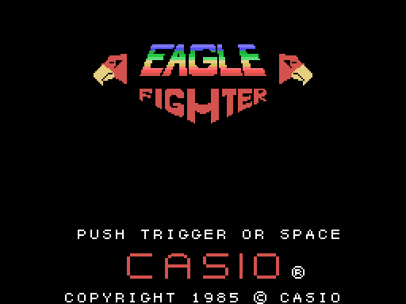
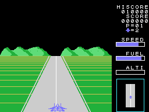
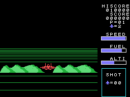
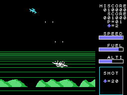
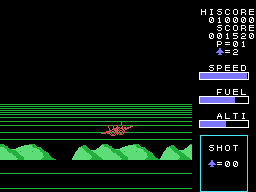
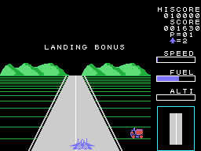
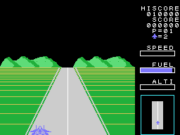
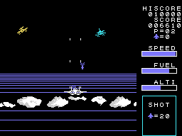

# La partida

*Eagle Fighter* es un juego de cazas visto desde detrás: el avión despega de una pista dibujada en perspectiva,
derriba las oleadas de aviones enemigos, vuelve y aterriza. El combustible se gasta todo el tiempo, y lo que queda
al aterrizar se cobra en puntos. Son dieciséis fases, en [Las fases](LAS-FASES.html).

Todos los GIF de esta web son la ROM **funcionando en openMSX** (un MSX1 japonés con C-BIOS, a 60 cuadros por
segundo): en cada cuadro se apuntan la VRAM, la RAM y los registros del VDP, y `tools/vdp.py` los pinta. Los de la
partida son un piloto sencillo escrito para ello (`tools/guiones/partida.tcl`): acelera por el centro de la pista,
despega, dispara, baja y aterriza.

## El título y la demostración

El título pinta el logotipo con sus dos águilas, PUSH TRIGGER OR SPACE, CASIO y el copyright (`titulo`, 0x80B0);
cada 8 cuadros entra un reactor por la derecha (`titulo_avion`, 0x9A2A). Sin botón durante unos segundos, empieza
la **demostración** en la fase 9 con DEMO PLAY: el juego mueve la palanca solo, acelera, despega y se estrella
(`interrupcion_demo`, 0x99AE).

## Los mandos

| | mando | teclado |
|---|---|---|
| la velocidad en la pista, la altura en el aire, a los lados | el mando 1 | los cursores |
| despegar y disparar | el botón | la barra |

El juego lee las dos palancas y **las suma** (`palanca_lee`, 0x998E). En el aire los mandos son los de un avión:
**arriba pica, abajo sube**.

## La pista y el despegue

En la pista, arriba acelera un paso cada 8 cuadros hasta 0x60, abajo frena dos, y con la palanca suelta la
velocidad baja poco a poco (`velocidad`, 0x85AB); la barra es SPEED. A los lados se mueve el avión; cerca de los
bordes da botes y fuera de la pista **se estrella** (`pista_lado`, 0x861F). Desde 0x10 de velocidad, unas **rachas**
de viento lo empujan de lado al azar (`viento`, 0x88CF).

Para despegar: abajo y el botón (`despega_empieza`, 0x869B). Con poca velocidad el avión da un salto y vuelve a
bajar; con 0x5A o más sigue subiendo, la pista se queda atrás y parpadea TAKE OFF:BONUS 1000PTS.: **1.000 puntos**
(`despegue`, 0x835D). Si despega fuera del centro de la pista, al volver a bajar se estrella.

## En el aire

Hasta **cuatro tiros** a la vez, que suben cuatro puntos por cuadro (`tiros`, 0x8934). Los aviones enemigos llegan
en oleadas; el recuadro SHOT del radar cuenta los que quedan por derribar (20 en la primera fase). Un enemigo, o uno
de sus tiros, que toca al avión lo estrella. Cada enemigo vale sus puntos, de 20 a 90 ([Las fases](LAS-FASES.html)).

## El combustible

El depósito empieza lleno (0xC0) y pierde una unidad cada 32 cuadros; la barra es FUEL, y por debajo de 16 suena una
alarma (`barras`, 0x8CB5). **Sin combustible el avión solo puede bajar** (`vuelo_cuadro`, 0x8752), y sin combustible
en la pista, antes de despegar, se estrella.

Desde la fase 3, el código tiene un repostaje en vuelo: después del enemigo grande, un avión cisterna dibujado con
casillas baja desde arriba de la pantalla, cuatro avisos, y con el avión debajo y la palanca abajo el depósito se
llena (`cisterna`, 0x8B08). **Ninguna grabación ha llegado hasta él**: está contado desde el código.

## El aterrizaje

Con la cuenta a 0, LANDING: la pista vuelve al radar (`aterrizaje`, 0x8A89). Bastante bajo, la pista se acerca por
el suelo; tocar el suelo **antes** de que llegue es estrellarse (`altura_barra`, 0x8D1A). El avión tiene que tocar
tierra en el centro de la pista y frenar hasta pararse; entonces LANDING BONUS: **10 puntos por cada unidad de
combustible que quede**, mientras un vehículo llega hasta el avión (`aterriza`, 0x9694). Después, la fase siguiente.

## Las vidas

La partida empieza con **dos vidas de reserva**, junto al avioncito; una más cada **20.000** puntos, hasta 9
(`puntos_suma_cien`, 0x97A8). Al estrellarse, el avión parpadea 160 cuadros con su música y la fase vuelve a
empezar (`nave_cae`, 0x95E6); sin vidas, GAME OVER (`game_over`, 0x967A).

