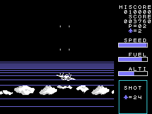

# Las fases

Dieciséis fases, de P=01 a P=16 en el marcador (0xE00A, de 0 a 15); después de la decimosexta, otra vez la primera
(`aterriza`, 0x972E). Cada fase saca sus datos de tablas de dieciséis entradas, una por fase.

| fase | enemigos que derribar (0x7020) | después del repostaje (0x7030) | oleadas |
|---:|---:|---:|---|
| 1 | 20 | 20 | 0x7CDF |
| 2 | 24 | 20 | 0x7CF4 (también la de la demostración) |
| 3 | 28 | 30 | 0x7D0C |
| 4 | 30 | 35 | 0x7D27 |
| 5 | 34 | 40 | 0x7D42 |
| 6 | 38 | 40 | 0x7D42 |
| 7 | 40 | 40 | 0x7D42 |
| 8 | 44 | 50 | 0x7D42 |
| 9 | 40 | 50 | 0x7D42 |
| 10 | 50 | 50 | 0x7D42 |
| 11 | 60 | 60 | 0x7D42 |
| 12 | 70 | 60 | 0x7D42 |
| 13 | 80 | 70 | 0x7D42 |
| 14 | 80 | 70 | 0x7D42 |
| 15 | 99 | 99 | 0x7D42 |
| 16 | 99 | 99 | 0x7D42 |

Las cuentas van en BCD, como las enseña el recuadro SHOT. El color del suelo cambia con la fase (0x8548 en la pista,
0x8558 en el aire) y también el paisaje del horizonte (0x8F94, 0x8FB4): la fase 2, en la grabación, es mar azul con
nubes.

## Las oleadas

Una oleada es una lista de entradas de tres bytes: el tipo de enemigo, la espera entre uno y otro y cuántos; 0xFF
con una dirección vuelve a ella, y las cinco listas vuelven a su principio (`oleada`, 0x7363). A la vez caben seis
enemigos y seis tiros enemigos (`enemigos_todos`, 0x7C5A); en la primera fase, solo tres enemigos.

## Los tipos de enemigo

Doce tipos ponen un enemigo nuevo arriba de la pantalla, a una distancia del avión y en el lado contrario a la mitad
en la que está (`tipo_1`-`tipo_12`, la tabla de 0x742F):

| tipo | movimiento | dibujo | color | puntos |
|---:|---:|---|---:|---:|
| 1 | 1 | 0x8C | 13 | 30 |
| 2 | 2 | 0x68 | 14 | 30 |
| 3 | 3 | 0x74 | 10 | 40 |
| 4 | 4 | 0x80 | 7 | 50 |
| 5 | 5, el grande | 0x98 | 15 | 90 |
| 6 | 3 | 0x74 | 10 | 60 |
| 7 | 4 | 0x8C | 7 | 20 |
| 8 | 4 | 0x68 | 14 | 20 |
| 9 | 4 | 0x5C | 13 | 20 |
| 10 | 4 | 0x8C | 10 | 30 |
| 11 | 4 | 0x68 | 7 | 30 |
| 12 | 6 | 0x50 | 10 | 40 |

Desde la fase 8, cada uno vale 10 más por fase: 10 más en la 8, 20 en la 9... (`enemigo_cae`, 0x71EC). Los
movimientos (`enemigo_mueve`, 0x78BA): el 1 y el 3 bajan rectos y luego giran paso a paso hacia una dirección final;
el 2 va hacia el centro y gira hasta cuatro veces; el 4 gira cada pocos cuadros y dispara cuando va hacia abajo; el
6 baja y se tuerce hacia el avión cuando pasa por encima. Cada paso sigue una de 16 direcciones (`paso`, 0x7B79, la
tabla de 0x7C3A).

Los enemigos disparan cuando están por encima del avión, salvo en la primera fase: rectos cuando están alineados con
él y, desde la fase 4, en diagonal cuando están a un lado (`enemigo_dispara`, 0x7040).

## El grande

Desde la fase 3, cuando la cuenta llega a 0, solo sale el grande (el tipo 5): cambia de color en cada cuadro, cruza
la pantalla de lado a lado y baja, una o dos veces según la fase (`mov_5`, 0x793E). Derribarlo trae el repostaje y
una cuenta nueva, la de la segunda columna (`repostaje_pide`, 0x77C8). En las fases 1 y 2 no hay grande: con la
cuenta a 0, el aterrizaje.
