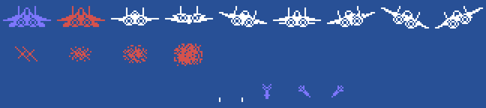
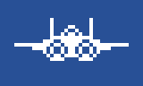
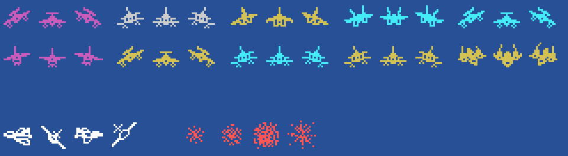

# Los sprites

Todo lo de esta página está **montado desde las tablas de la ROM** con `tools/hojas.py`: los dibujos son los 0x800
bytes de 0xB800 que `sprites_dibujos` (0x987A) pone tal cual en 0x3800, y cada figura se arma con los dibujos, los
colores y los sitios que le da el código. Ninguna de estas imágenes es una captura.

**Cotejado con openMSX** en las tres grabaciones de esta web:

- la tabla de dibujos de los sprites (VRAM 0x3800-0x3FFF) es **idéntica** a la del juego en 17.190 cuadros (otros
  3 pillan la copia a medias);
- los dos sprites del avión (0xE100) casan en 12.642 cuadros, y estrellado en 2.678; en 8 una mitad ya ha cambiado
  y la otra aún no; **5 sin explicar**;
- los enemigos en el aire (el sprite 0xE128 + 8 × su número, sus datos 0xE360 + 32 × él) llevan el dibujo y el
  color de su tipo en **8.018 cuadros, 0 distintos**, y están estallando en otros 791;
- los tiros de los enemigos (los sprites 4-9) en 2.370 cuadros, y estallando en 151; **0 distintos**.

## El avión

Dos sprites: el dibujo y el dibujo + 4, 16 puntos a la izquierda (`fase_empieza`, 0x822B). En la pista 0x00, en
azul claro y rojo oscuro, que cambian cada 2 cuadros (`vuelo_pista`, 0x8589); en el aire, según la palanca
(`vuelo_palanca`, 0x8774): quieta 0x08, arriba 0x18 (pica), a la derecha 0x20, abajo 0x10 (sube), a la izquierda
0x30, y 0x28 o 0x38 en las diagonales, en blanco y rojo oscuro cada 2 cuadros (`avion_color`, 0x88B4). Estrellado
(`nave_cae`, 0x95E6), los dos sprites llevan el mismo dibujo, 0xE8, 0xEC, 0xF0 y 0xF4 cada 4 cuadros, uno 6 puntos
a la izquierda y el otro 5 a la derecha. Abajo, su tiro (0xF8, blanco, `tiros` 0x8934) y los de los enemigos (0xAC
recto, 0xA4 y 0xA8 en diagonal, azul claro, `enemigo_dispara` 0x7073):

En el aire con la palanca en sus ocho direcciones, parpadeando, y estrellado, al ritmo del juego:

## Los enemigos

Un sprite cada uno, con el dibujo y el color de su tipo (`tipo_1` ... `tipo_12`): 0x8C en magenta, cian o amarillo
oscuro, 0x68 en gris, cian o amarillo oscuro, 0x74 en amarillo oscuro, 0x80 en cian, 0x5C en magenta y 0x50 en
amarillo oscuro; cada uno de frente y con su dibujo - 4 o + 4 cuando va hacia un lado u otro (`paso`, 0x7B79). Abajo,
el grande (0x94, 0x98, 0x9C y 0xA0 en blanco, por los pasos de 0x796C) y la explosión (0xEC, 0xF0 y 0xF4, o 0xFC
desde el tipo 6, en rojo, `explosion1` 0x727D; en la mitad izquierda de la pantalla el primer paso no cambia el
dibujo, solo el color):

Derribado: tres dibujos de 4 cuadros cada uno, al ritmo del juego:

